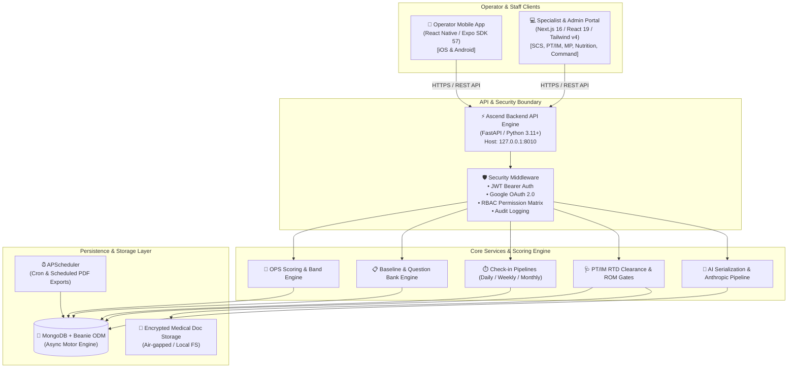
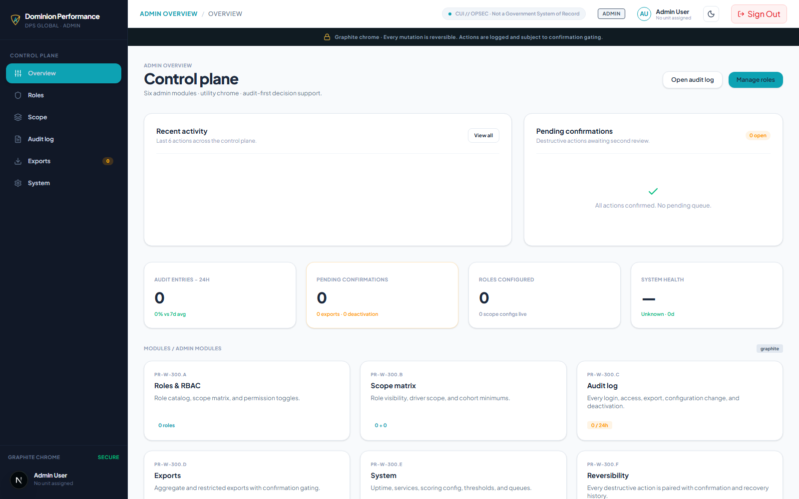
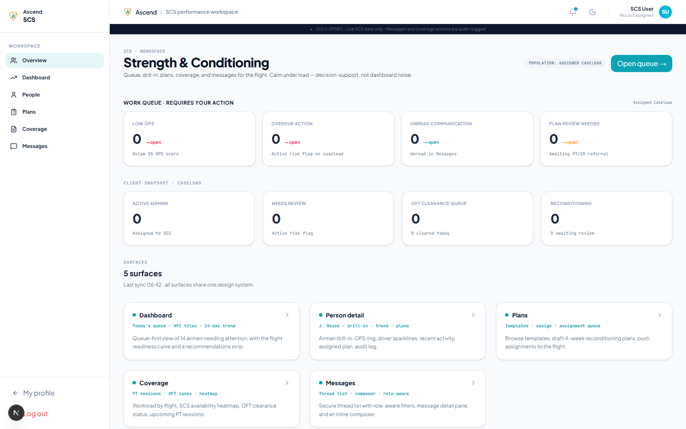
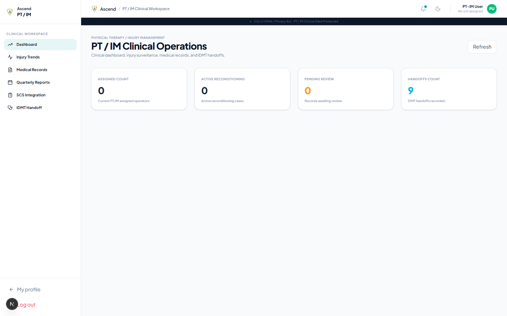
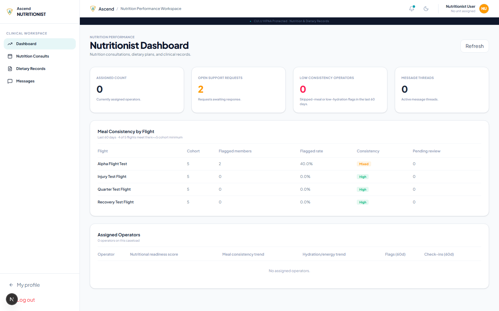
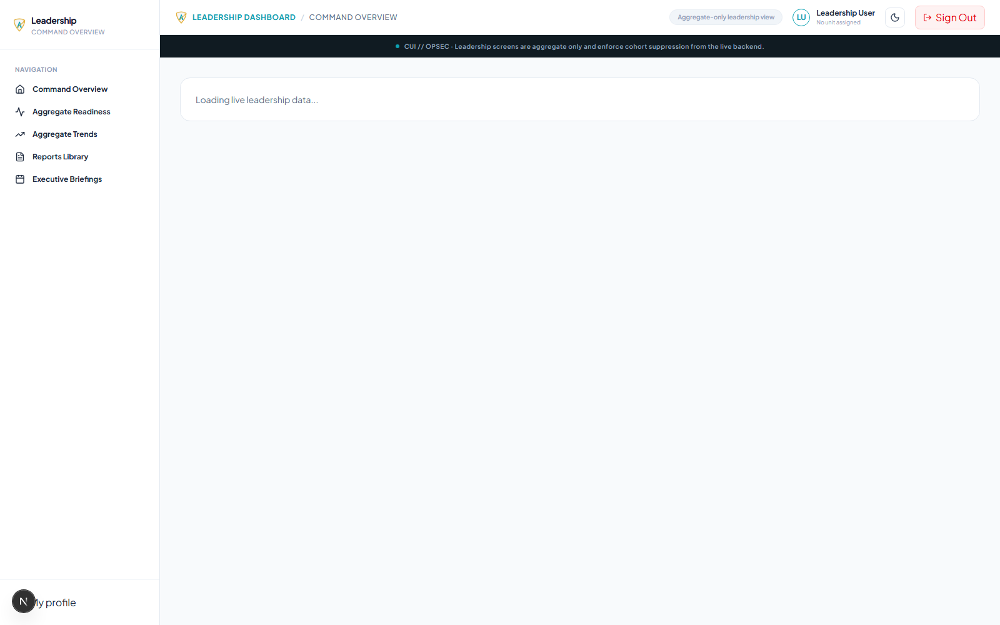
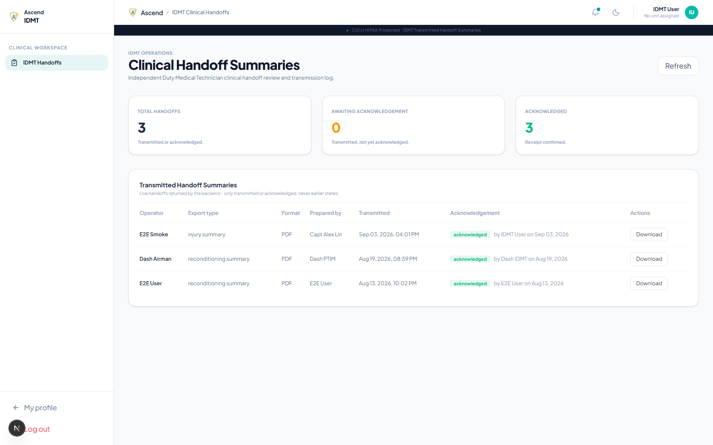

# ⚡ Ascend — Tactical Readiness & Human Performance Optimization (HPO) Platform

<div align="center">

[](https://www.python.org/)
[](https://fastapi.tiangolo.com/)
[](https://nextjs.org/)
[](https://reactnative.dev/)
[](https://expo.dev/)
[](https://www.mongodb.com/)
[](https://www.typescriptlang.org/)
[](https://www.anthropic.com/)
[](LICENSE)
[](docs/SECURITY_CHECKLIST.md)

<p align="center">
  <b>A mission-critical, multi-echelon human performance and operational readiness ecosystem engineered for tactical operators, medical providers, performance specialists, and command leadership.</b>
</p>

[Explore Architecture](#-system-architecture) •
[OPS Scoring Engine](#-operational-performance-score-ops-engine) •
[Specialist Workspaces](#-multi-role-ecosystem) •
[Quick Start](#-quick-start--local-development) •
[API Reference](#-api-documentation--endpoints)

</div>

---

## 📌 Table of Contents

- [Overview & Operational Mission](#-overview--operational-mission)
- [System Architecture](#-system-architecture)
- [Operational Performance Score (OPS) Engine](#-operational-performance-score-ops-engine)
- [Multi-Role Ecosystem](#-multi-role-ecosystem)
- [Repository & Monorepo Structure](#-repository--monorepo-structure)
- [Tech Stack Overview](#-tech-stack-overview)
- [UI & Specialist Dashboard Showcase](#-ui--specialist-dashboard-showcase)
- [Quick Start & Local Development](#-quick-start--local-development)
  - [Prerequisites](#prerequisites)
  - [1. Backend Service (`ascend-backend`)](#1-backend-service-ascend-backend)
  - [2. Specialist Web Portal (`ascend-admin`)](#2-specialist-web-portal-ascend-admin)
  - [3. Operator Mobile App (`ascend-app`)](#3-operator-mobile-app-ascend-app)
- [Environment Configuration](#-environment-configuration)
- [API Documentation & Endpoints](#-api-documentation--endpoints)
- [Security, Privacy & Medical Governance](#-security-privacy--medical-governance)
- [Testing & Quality Assurance](#-testing--quality-assurance)
- [Contributing & Development Guidelines](#-contributing--development-guidelines)

---

## 🎖️ Overview & Operational Mission

**Ascend** is an enterprise-grade tactical wellness, readiness, and return-to-duty (RTD) platform built to optimize operator resilience, reduce musculoskeletal and cognitive downtime, and provide command leadership with privacy-preserving operational insights.

### Core Capabilities:
- **Comprehensive Multi-Pillar Readiness**: Evaluates holistic readiness across 5 distinct domains (Physical, Sleep, Mental, Nutritional, and Spiritual).
- **Automated Risk Stratification**: Proactively surfaces acute indicators (pain, limitation, sleep deficit, high stress) and routes alerts to the appropriate specialist.
- **Return-To-Duty (RTD) Clearance Gates**: Provides clinical oversight, Range of Motion (ROM) measurement tracking, and protocol progression before operators resume unrestricted duty.
- **Privacy-Preserving Leadership Insights**: Employs mathematical $k$-anonymity suppression to give leadership aggregate readiness heatmaps while safeguarding individual medical confidentiality and OPSEC boundaries.
- **AI-Augmented Performance Coaching**: Generates structured, serialized AI payloads powered by Claude 3.5 / 4.6 for contextualized recommendations and recovery pathways.

---

## 🏗️ System Architecture

Ascend uses an asynchronous, decoupled monorepo architecture designed for high availability, security isolation, and rapid micro-interactions.



---

## 🧮 Operational Performance Score (OPS) Engine

The **Operational Performance Score (OPS)** is calculated algorithmically using weighted inputs from the 20-question baseline survey, periodic check-ins, and contextual threshold flags.

### 1. Weighted Formula
$$\text{OPS} = (\text{Physical} \times 0.25) + (\text{Sleep} \times 0.20) + (\text{Mental} \times 0.20) + (\text{Nutritional} \times 0.20) + (\text{Spiritual} \times 0.15)$$

### 2. Readiness Bands & Action Triggers

| Score Range | Operational Band | User-Facing Indication | System & Specialist Response |
| :---: | :---: | :--- | :--- |
| **85 – 100** | **Ready** | Peak performance; prepared for high-intensity duty. | Standard training plan; maintain baseline. |
| **70 – 84** | **Monitor** | Generally operational; minor fatigue or recovery flag. | Micro-recovery advice; coach watchlist. |
| **55 – 69** | **Caution** | Readiness impaired; moderate deficit in one or more pillars. | Specialist notification; modified training volume. |
| **40 – 54** | **Action Needed** | Significant risk; performance bottleneck or active pain. | Active specialist triage; clinical consult recommended. |
| **Below 40** | **High Priority** | Critical deficit, acute limitation, or severe stress event. | Immediate clinical/medical hold; RTD review. |

---

## 👥 Multi-Role Ecosystem

Ascend provides role-specific, compartmentalized interfaces tailored to each echelon of the military unit:

```
┌───────────────────────────────────────────────────────────────────────────────┐
│                          ASCEND ROLE ECOSYSTEM                                │
├──────────────────────────┬────────────────────────────────────────────────────┤
│ 🛡️ Airman / Operator     │ • Micro check-ins (Daily / Weekly / Monthly)       │
│                          │ • Personal OPS score & historical readiness trends │
│                          │ • Push notifications, workouts & nutrition logs    │
├──────────────────────────┼────────────────────────────────────────────────────┤
│ 🏋️ SCS (Strength & S&C)  │ • Operator training compliance & workload tracking │
│                          │ • Physical trend flags & velocity metrics          │
│                          │ • Integrated coordination with PT/IM staff         │
├──────────────────────────┼────────────────────────────────────────────────────┤
│ 🩺 PT / IM (Injury Mgmt) │ • Clinical intake & injury status logs             │
│                          │ • Return-to-Duty (RTD) clearance gates             │
│                          │ • Range of Motion (ROM) assessment records         │
├──────────────────────────┼────────────────────────────────────────────────────┤
│ 🧠 Mental Performance    │ • Cognitive stress markers & focus metrics         │
│                          │ • Crisis & support request triage                  │
│                          │ • Protected consultation notes                     │
├──────────────────────────┼────────────────────────────────────────────────────┤
│ 🥗 Registered Dietitian  │ • Flight meal consistency & fueling compliance     │
│                          │ • Macro-target assignments & hydration tracking    │
├──────────────────────────┼────────────────────────────────────────────────────┤
│ 🎖️ Command Leadership    │ • High-level unit operational readiness indices   │
│                          │ • k-anonymity cohort privacy protections           │
│                          │ • Trend analytics (non-clinical, OPSEC-cleared)    │
├──────────────────────────┼────────────────────────────────────────────────────┤
│ 📋 IDMT / Med Governance │ • Digital chain of custody for medical records     │
│                          │ • Base access & badge compliance pass tracking     │
│                          │ • Regulated export packages & fly-away kits        │
├──────────────────────────┼────────────────────────────────────────────────────┤
│ ⚙️ Super Administrator   │ • Role-Based Access Control (RBAC) provisioning   │
│                          │ • Comprehensive cryptographic audit trail          │
│                          │ • System configuration & diagnostic health monitors│
└──────────────────────────┴────────────────────────────────────────────────────┘
```

---

## 📁 Repository & Monorepo Structure

```text
Ascend-wellness_v2/
├── ascend-backend/               # Core FastAPI Python Backend
│   ├── app/
│   │   ├── api/                  # Versioned API routes (/api/v1)
│   │   ├── core/                 # Config, DB connection, logging, scheduler
│   │   ├── models/               # Beanie ODM MongoDB document models
│   │   ├── modules/              # Domain-driven feature modules:
│   │   │   ├── auth/             # JWT authentication & Google OAuth
│   │   │   ├── onboarding/       # 20-question baseline & scoring engine
│   │   │   ├── checkins/         # Daily, weekly, monthly check-in pipelines
│   │   │   ├── dashboards/       # Role-specific backend aggregation endpoints
│   │   │   ├── oft/              # Operational Fitness Test tracking
│   │   │   ├── records/          # Medical records & governance workflows
│   │   │   ├── workouts/         # Workout logs & training volume
│   │   │   └── admin/            # Superadmin controls & audit logs
│   │   ├── schemas/              # Pydantic v2 validation models
│   │   └── services/             # Core business logic services (40+ services)
│   ├── docs/                     # Architectural, API, and compliance documentation
│   ├── tests/                    # Pytest test suite & coverage
│   ├── requirements.txt          # Python dependencies
│   └── run.py                    # Entrypoint runner (default: 127.0.0.1:8010)
│
├── ascend-admin/                 # Specialist & Command Portal (Next.js 16)
│   ├── src/
│   │   ├── app/                  # Next.js App Router (Turbopack enabled)
│   │   │   ├── (auth)/           # Role-based login routes
│   │   │   └── (dashboard)/      # Specialist workspaces (SCS, PT/IM, MP, Admin)
│   │   ├── components/           # Reusable UI component library (Tailwind v4)
│   │   ├── features/             # Feature-specific components, types, and hooks
│   │   ├── store/                # Zustand client state stores
│   │   └── lib/                  # Utilities, API client, and formatters
│   ├── package.json              # Next.js dependencies (React 19, Lucide, Tailwind v4)
│   └── next.config.ts            # Next.js framework configuration
│
├── ascend-app/app/               # Operator Mobile Companion App (Expo SDK 57)
│   ├── src/                      # Mobile screens, navigation, and stores
│   ├── assets/                   # Vector graphics, fonts, and icons
│   ├── app.json                  # Expo application manifest
│   └── package.json              # React Native 0.86, Redux Toolkit, Reanimated 4
│
└── dashboard-screenshots/        # UI captures & visual design specifications
```

---

## 💻 Tech Stack Overview

| Layer | Technologies | Key Highlights |
| :--- | :--- | :--- |
| **Backend API** | **FastAPI 0.116+**, **Python 3.11+**, **Uvicorn** | Fully async I/O, Pydantic v2 validation, OpenAPI 3.1 / Swagger auto-generation |
| **Database & ODM** | **MongoDB**, **Beanie 1.29+**, **Motor** | Document schema enforcement, async query indexing, flexible telemetry storage |
| **AI Insights** | **Anthropic Claude (3.5 Sonnet / 4.6)** | Context-aware recovery recommendation synthesis and prompt orchestration |
| **Background Jobs** | **APScheduler 3.10+** | Recurring check-in reminders, scheduled PDF reports, compliance scans |
| **Admin Web Portal**| **Next.js 16**, **React 19**, **TypeScript 5** | Turbopack compilation, Tailwind CSS v4, Zustand state, Lucide icons |
| **Mobile App** | **Expo SDK 57**, **React Native 0.86** | Cross-platform (iOS/Android), Redux Toolkit, Expo Router, Reanimated 4 |
| **Security & Auth** | **JWT**, **Google OAuth2**, **Bcrypt** | Encrypted token storage, granular RBAC, IP & session audit logging |

---

## 📸 UI & Specialist Dashboard Showcase

> *The Ascend Portal provides dedicated views configured for specific specialist roles with strict data minimization:*

<div align="center">

| **Admin Operational Center** | **SCS Operator Readiness** |
| :---: | :---: |
|  |  |
| *Role provisioning, access passes & audit trail* | *Physical readiness scores, trends & training compliance* |

| **PT / IM Return-to-Duty Gate** | **Nutritionist Flight Fueling** |
| :---: | :---: |
|  |  |
| *Injury queue, ROM progress & clearance milestones* | *Flight meal consistency, macro targets & hydration* |

| **Leadership Readiness Index** | **IDMT Documentation Handoffs** |
| :---: | :---: |
|  |  |
| *k-anonymity aggregate readiness & operational heatmap* | *Chain of custody, pass logs & medical record audits* |

</div>

---

## 🚀 Quick Start & Local Development

### Prerequisites

Ensure you have the following installed on your host workstation:
- **Python**: `3.11` or higher
- **Node.js**: `20.x` or higher (`npm` v10+)
- **MongoDB**: `7.0+` running locally or access to a MongoDB Atlas cluster
- **Git**

---

### 1. Backend Service (`ascend-backend`)

The backend is built with FastAPI and runs on `127.0.0.1:8010` by default.

```bash
# Navigate to the backend directory
cd ascend-backend

# Create and activate a Python virtual environment
python -m venv .venv

# On Windows (PowerShell):
.\.venv\Scripts\Activate.ps1
# On macOS / Linux:
source .venv/bin/activate

# Install required dependencies
pip install -r requirements.txt

# Configure your environment file
cp .env.example .env
```

#### Run the API Server:
```bash
python run.py
```

- **API Base URL**: `http://127.0.0.1:8010`
- **Swagger Interactive UI**: [http://127.0.0.1:8010/docs](http://127.0.0.1:8010/docs)
- **ReDoc Documentation**: [http://127.0.0.1:8010/redoc](http://127.0.0.1:8010/redoc)
- **Health Check**: [http://127.0.0.1:8010/api/v1/health](http://127.0.0.1:8010/api/v1/health)

> [!TIP]
> You can set `DB_REQUIRED=false` in `.env` to start the backend in lightweight mock mode without connecting to a live MongoDB instance!

---

### 2. Specialist Web Portal (`ascend-admin`)

The specialist dashboard is built with Next.js 16 and React 19.

```bash
# Navigate to the admin portal directory
cd ascend-admin

# Install dependencies
npm install

# Copy environment variables
cp .env.example .env.local

# Start the Next.js development server (with Turbopack)
npm run dev
```

- **Portal URL**: [http://localhost:3000](http://localhost:3000)

```bash
# Available utility scripts
npm run build      # Build for production
npm run lint       # Run ESLint validation
npm run typecheck  # Run TypeScript type safety check
npm run check      # Combined lint and typecheck
```

---

### 3. Operator Mobile App (`ascend-app`)

The operator app is built using Expo SDK 57 and React Native.

```bash
# Navigate to the mobile app directory
cd ascend-app/app

# Install dependencies
npm install

# Start the Expo development server
npx expo start
```

Press `a` in the terminal to open in an **Android Emulator**, `i` for **iOS Simulator**, or scan the QR code with the **Expo Go** app on your physical device.

---

## ⚙️ Environment Configuration

### Backend (`ascend-backend/.env`)

```ini
# Application Core
APP_NAME="Ascend Backend"
APP_ENV="development"
APP_DEBUG=true
APP_HOST="127.0.0.1"
APP_PORT=8010
API_V1_PREFIX="/api/v1"

# Security & Tokens
SECRET_KEY="replace-with-a-secure-random-secret-key"
ACCESS_TOKEN_EXPIRE_MINUTES=60
REFRESH_TOKEN_EXPIRE_MINUTES=10080

# Database Settings
MONGODB_URL="mongodb://localhost:27017"
MONGODB_DB_NAME="ascend_db"
DB_REQUIRED=false

# Google OAuth2 & Communication
GOOGLE_CLIENT_IDS="your-google-oauth-client-ids"
LOGIN_EMAIL="admin@ascend.mil"

# AI Integration
AI_PROVIDER_API_KEY="your-anthropic-api-key"
ANTHROPIC_MODEL="claude-sonnet-4-6"

# Medical Records & Storage
MEDICAL_RECORD_STORAGE_DIR="./storage/medical_records"
POLICY_VERSION="ascend-ia-01@1.4.0"
```

### Admin Portal (`ascend-admin/.env.local`)

```ini
NEXT_PUBLIC_APP_NAME="Ascend Admin"
NEXT_PUBLIC_APP_URL="http://localhost:3000"
NEXT_PUBLIC_API_BASE_URL="http://127.0.0.1:8010/api/v1"
```

---

## 📡 API Documentation & Endpoints

Ascend exposes a modular REST API structured around `/api/v1/`:

<details>
<summary><b>🔍 View Core API Endpoint Reference (Click to expand)</b></summary>
<br>

| Domain | Method | Endpoint | Description |
| :--- | :---: | :--- | :--- |
| **System** | `GET` | `/api/v1/health` | Service liveness, database status, and version |
| **Auth** | `POST` | `/api/v1/auth/register` | User onboarding registration |
| **Auth** | `POST` | `/api/v1/auth/login` | Credentials exchange for JWT access & refresh tokens |
| **Auth** | `POST` | `/api/v1/auth/google` | Google OAuth2 ID token verification |
| **Auth** | `POST` | `/api/v1/auth/refresh` | Refresh expired access tokens |
| **Onboarding** | `GET` | `/api/v1/onboarding/first-use-status`| Check if first-time baseline survey is pending |
| **Onboarding** | `GET` | `/api/v1/onboarding/questions` | Fetch 20-question normalized readiness bank |
| **Onboarding** | `POST` | `/api/v1/onboarding/complete` | Submit survey, calculate baseline OPS, trigger AI payload |
| **Check-ins** | `POST` | `/api/v1/checkins/daily` | Log daily pulse, soreness, sleep, and nutrition data |
| **Check-ins** | `POST` | `/api/v1/checkins/weekly` | Log weekly volume, readiness check, and pain flags |
| **Dashboards** | `GET` | `/api/v1/dashboards/scs` | SCS specialist cohort readiness and compliance rows |
| **Dashboards** | `GET` | `/api/v1/dashboards/ptim` | PT/IM injury queue, ROM metrics, and RTD gates |
| **Dashboards** | `GET` | `/api/v1/dashboards/mp` | Mental performance indicators & support tickets |
| **Dashboards** | `GET` | `/api/v1/dashboards/leadership`| k-anonymity aggregated readiness index for Command |
| **Records** | `POST` | `/api/v1/records/upload` | Upload and encrypt medical/clearance documents |
| **Admin** | `GET` | `/api/v1/admin/audit-logs` | Fetch immutable administrative and access audit trail |

</details>

---

## 🔒 Security, Privacy & Medical Governance

Ascend complies with modern defense information security principles and strict healthcare privacy requirements:

- **$k$-Anonymity Data Masking**: Leadership and command portals suppress any cohort aggregation smaller than a threshold ($k \ge 5$) to prevent inadvertent deanonymization of operators.
- **Controlled Unclassified Information (CUI)**: Implements banner demarcation, access controls, and strict session limits.
- **Granular RBAC**: Strict cryptographic barrier between clinical/injury notes (PT/IM, Medical) and operational readiness summaries (Command).
- **Comprehensive Audit Trail**: Every access event, record inspection, role change, and export generation is cryptographically timestamped and logged in `audit_logs`.
- **Zero Raw Secret Storage**: Passwords hashed with `bcrypt`, token rotations strictly managed via `python-jose`.

---

## 🧪 Testing & Quality Assurance

Ascend enforces rigorous testing standards across backend and frontend layers:

```bash
# Backend Test Suite (Pytest)
cd ascend-backend
pytest tests/ -v

# Admin TypeScript Validation & Linting
cd ascend-admin
npm run check

# Mobile App Linting
cd ascend-app/app
npm run lint
```

---

## 🤝 Contributing & Development Guidelines

1. **Branching Strategy**: Branch from `main` using descriptive naming conventions (`feat/`, `fix/`, `docs/`, `security/`).
2. **Commit Hygiene**: Follow Conventional Commits format (`feat: implement RTD gate verification`, `fix: resolve JWT expiration edge-case`).
3. **OPSEC & Secret Protection**: Never commit `.env`, sensitive credentials, or real operator PII to git.
4. **Pull Requests**: Submit PRs with test coverage and schema validation pass criteria.

---

<div align="center">

**Ascend Wellness Platform** • Built for Operator Resilience & Tactical Superiority

Developed by the **Ascend Engineering Team** • Confidential & Proprietary

</div>
